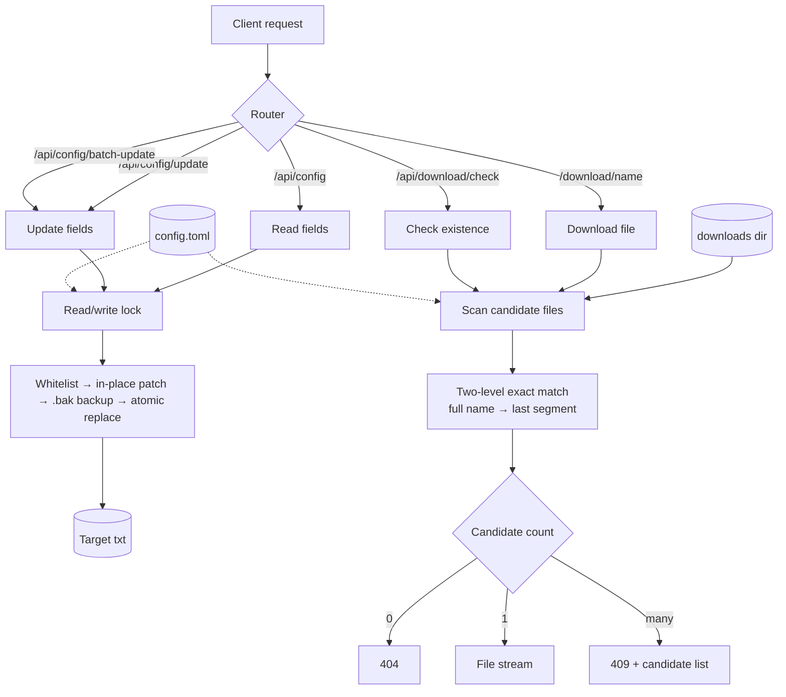

# config-api

**English** | [简体中文](README.zh-CN.md)

A small HTTP service for an internal network. It does two things: **updates field values in a plain-text config file on request**, and **downloads files from a configured directory by name**. No database, and the target machine needs no Python / JVM / Rust.


> Fully implemented and ready to deploy. To learn how the code was built step by step, see the document index at the end.

## Features

- Read config fields: `GET /api/config`
- Update one field: `POST /api/config/update`
- Batch update, all-or-nothing: `POST /api/config/batch-update`
- Field whitelist — only fields listed in `config.toml` can be changed
- Automatic `.bak` backup before every write; temp file plus atomic replace, so a partial file is never left behind
- Download files: `GET /download/{name}` — an ID alone can find a file whose name has a timestamp prefix
- Check before downloading: `POST /api/download/check` returns existence, count, and matching file names
- Download directory, allowed file types, and size limits are all configured in `config.toml`
- Startup validation: a broken config stops the service immediately instead of failing at request time

## How It Works



Two paths: config edits go through the lock, whitelist, and atomic replace; downloads go through directory scanning and two-level exact matching. `config.toml` controls which fields may change, which directories are searched, and which file types are allowed.

## What You Get

A deployment folder needs only these items:

```text
config-api/
├── config-api.exe      # config-api on Linux / macOS, no .exe suffix
├── config.toml         # every setting lives here
├── data/
│   ├── SmartViewConfig.txt   # the file to be edited (replace with your real file)
│   └── downloads/            # files that may be downloaded (sample files can be removed)
└── README.md
```

The target machine needs **no runtime**. Copy the folder, edit `config.toml`, and run it.

## Quick Start

### 1. Edit the config

Open `config.toml` and check at least these three things:

- `[server].host`: keep `127.0.0.1` for local-only use; for LAN access, use this machine's internal IP (e.g. `192.168.1.10`)
- `[files].base_dir` and `file_name`: point at the txt file you want to edit
- `[download].roots`: point at the directory that holds downloadable files

> **On Windows, backslashes must be doubled**: `C:\\SmartView\\config`. A single backslash fails to parse.

### 2. Start the service

On Windows, double-click `config-api.exe`, or run it in PowerShell:

```powershell
.\config-api.exe
```

On a development machine, `cargo run` works too. The service listens on `http://127.0.0.1:18981` by default.

To use a different config file (e.g. for testing):

```powershell
.\config-api.exe D:\config-api\config-test.toml
```

### 3. Verify

```bash
curl http://127.0.0.1:18981/api/config
```

If you see `{"ok":true,"file":"...","fields":[...]}`, it is running.

### 4. Stop

Press `Ctrl+C` in the running window, or just close the window if you double-clicked the exe.

## Configuration Reference

`config.toml` sits next to the executable. **Relative paths are resolved from the config file's directory**, not from the current working directory. A misspelled key stops startup.

```toml
[server]
host = "127.0.0.1"
port = 18981

[files]
base_dir = "./data"
file_name = "SmartViewConfig.txt"
backup = true

[allowed_fields]
fields = ["Thickness", "Temper", "Alloy", "Entry Width", "Exit Width", "DataName"]

[cors]
allowed_origins = []
allow_credentials = false

[download]
enabled = true
roots = ["./data/downloads"]
separator = "_"
extensions = ["txt", "csv", "xls", "xlsx"]
case_insensitive = true
max_file_size = 104857600
allow_subdirs = false
follow_symlinks = false
```

### Server and target file

| Key | Meaning |
|---|---|
| `server.host` | Listen IP. Must be an IP literal, not a hostname |
| `server.port` | Port, must not be `0`. Default `18981` |
| `files.base_dir` | Directory of the target file; must exist at startup |
| `files.file_name` | File name only — no path components |
| `files.backup` | When `true`, write a `.bak` copy before each edit |

### Field whitelist

`allowed_fields.fields` lists the field names that may be changed through the API. Anything outside the list is rejected with 400. The write API replaces only the value line below each `@field`; comments, blank lines, and line endings are preserved as-is.

### Download settings

| Key | Meaning |
|---|---|
| `download.enabled` | When `false`, neither download nor check routes are registered |
| `download.roots` | Directories to search; more than one is allowed |
| `separator` | Name separator, `_` by default |
| `extensions` | Allowed file types, lowercase without the dot. Files outside this list are neither matched nor downloaded |
| `case_insensitive` | When `true`, comparisons ignore case — keeps Windows and Linux consistent |
| `max_file_size` | Byte limit per file; over the limit is skipped. `0` means unlimited |
| `allow_subdirs` | `false` scans only the top level; `true` recurses |
| `follow_symlinks` | Keep `false` so a link cannot point outside the root |

### Browser CORS (usually unchanged)

`[cors].allowed_origins` empty means same-origin only. To let a front-end page call the API, add its address, e.g. `["http://localhost:5173"]`. CORS is not authentication — do not treat it as a security boundary.

## Target File Format

The txt file being edited stores a field name on one line and its value on the next:

```text
# Do not edit by hand
@DataName
TT26071311A002

@Thickness
25
@Temper
T3
```

- A line starting with `@` declares a field; the next line is its value
- Comments, blank lines, and line endings (CRLF / LF) are preserved; only the value line is replaced
- A duplicate field is rejected rather than guessed
- Values cannot contain newlines or start with `@`
- Save the file as UTF-8; GBK files will show garbled text

## Downloading Files

Suppose the directory contains:

```text
data/downloads/20231123_164957_AS9283331.xlsx
```

All three requests below find it:

```bash
# ID plus type (recommended)
curl -OJ http://127.0.0.1:18981/download/AS9283331.xlsx

# ID only; the allowed types come from extensions in config.toml
curl -OJ http://127.0.0.1:18981/download/AS9283331

# Full file name
curl -OJ http://127.0.0.1:18981/download/20231123_164957_AS9283331.xlsx
```

Matching uses two levels of **exact comparison** — no fuzzy search:

1. The request equals the full file name
2. The request equals the last segment after splitting on `separator`; with an ID-only request, the segment with its extension removed is also compared

Results are fixed: 0 candidates → 404, 1 → the file, **more than one → 409 with the candidate names listed, never a silent guess**. For example, if `..._AS9283331.csv` also exists, `AS9283331` alone returns 409 — retry with the full name.

The response carries `Content-Disposition: attachment`, so browsers save it as a file, and non-ASCII names are encoded correctly.

## HTTP API

All JSON endpoints use port `18981` unless you changed it.

### Read fields

```bash
curl http://127.0.0.1:18981/api/config
```

```json
{"ok":true,"file":"./data/SmartViewConfig.txt","fields":[{"name":"Thickness","value":"25"}]}
```

### Update one field

```bash
curl -X POST http://127.0.0.1:18981/api/config/update \
  -H "Content-Type: application/json" \
  -d '{"name":"Thickness","value":"25"}'
```

```json
{"ok":true,"file":"./data/SmartViewConfig.txt","applied":["Thickness"],"count":1}
```

### Batch update

If any item fails validation or names a missing field, **nothing is written**.

```bash
curl -X POST http://127.0.0.1:18981/api/config/batch-update \
  -H "Content-Type: application/json" \
  -d '{"items":[{"name":"Thickness","value":"25"},{"name":"Temper","value":"T3"}]}'
```

### Check whether a file exists (no download)

```bash
curl -X POST http://127.0.0.1:18981/api/download/check \
  -H "Content-Type: application/json" \
  -d '{"name":"A12331","type":"xls"}'
```

```json
{"exist":true,"count":1,"files":["20231209_120312_A12331.xls"]}
```

`type` is optional; omit it to match any allowed type. `files` is always an array and `count` is always a number. No match returns `{"exist":false,"count":0,"files":[]}` with status 200. `type` must be one of the configured `extensions`, otherwise 400.

### PowerShell examples

```powershell
Invoke-RestMethod -Uri http://127.0.0.1:18981/api/config/update -Method Post `
  -ContentType 'application/json' -Body '{"name":"Thickness","value":"25"}'

Invoke-WebRequest -Uri http://127.0.0.1:18981/download/AS9283331.xlsx -OutFile AS9283331.xlsx
```

### Status codes

| Status | Meaning |
|---|---|
| 400 | Bad parameter: field not whitelisted, bad value, or `type` not allowed |
| 404 | No matching file for download |
| 409 | Multiple matches — retry with one of the returned full names |
| 500 | File I/O failure, or download directory unavailable |

## Packaging and Distribution

### Build

```bash
cargo build --release
```

The artifact is `target/release/config-api` (Windows: `target\release\config-api.exe`). **Do not distribute the debug binary produced by `cargo run`.**

Zip this folder:

```text
config-api-1.0.0-windows-x64/
├── config-api.exe
├── config.toml
├── data/SmartViewConfig.txt
├── data/downloads/
└── README.md
```

### On the target machine

1. Unzip anywhere (a fixed path is convenient for service scripts)
2. Edit `config.toml` for the real environment
3. Put the target txt in `files.base_dir` and downloadable files in `download.roots`
4. Double-click the exe or start it from a command line
5. Verify from another machine: `http://internal-ip:18981/api/config`

### LAN access

Local only: keep `host = "127.0.0.1"`.

For other machines on the LAN: set `host` to **this machine's internal IP** (e.g. `192.168.1.10`) and open port `18981` in Windows Firewall:

```powershell
New-NetFirewallRule -DisplayName "config-api-18981" `
  -Direction Inbound -Protocol TCP -LocalPort 18981 `
  -RemoteAddress 192.168.1.0/24 -Action Allow
```

Adjust the subnet and port to match your environment. **After deployment, try the port from outside the LAN to confirm it is unreachable** — this build has no login authentication; the network boundary is the security boundary.

### Cross-platform notes

- macOS binaries must be built on macOS
- The Linux musl build is fully static and works regardless of the target's glibc version (Kylin, UOS, openEuler)
- Windows MSVC builds need the VC++ runtime; use a static-CRT build or install the VC++ Redistributable on bare machines
- Unsigned executables may be flagged by antivirus; code signing is recommended for internal distribution

## Troubleshooting

| Symptom | Cause / fix |
|---|---|
| Exits immediately: `base_dir` does not exist | Wrong path, or Windows backslashes not doubled |
| `download.roots` does not exist | Create the download directory at the configured path |
| `Address already in use` | Port taken; change `server.port` or stop the old process |
| Unreachable from the LAN | Check `host` is the internal IP and the firewall rule is in place |
| Download returns 404 | Check the type is in `extensions` and the name's last segment matches |
| Download returns 409 | Multiple candidates — retry with a full name from the response |
| `os error 32` on write | File locked by Notepad or a sync client; close it |
| Garbled CJK text | Target file is GBK; re-save as UTF-8 |
| Browser CORS error | Add the front-end origin to `[cors].allowed_origins` |

## Document Index

- This file: run, configure, API, and packaging for users
- [`docs/Axum配置接口_完整实现与打包指南.md`](docs/Axum配置接口_完整实现与打包指南.md): for developers — module-by-module code notes and the packaging matrix (Chinese)
- [`docs/Axum配置接口_手把手教程.md`](docs/Axum配置接口_手把手教程.md): for learners — from Hello World to the final version, step by step (Chinese)

## License

Released under the [MIT License](LICENSE). Copyright (c) 2026 jasonbu163
