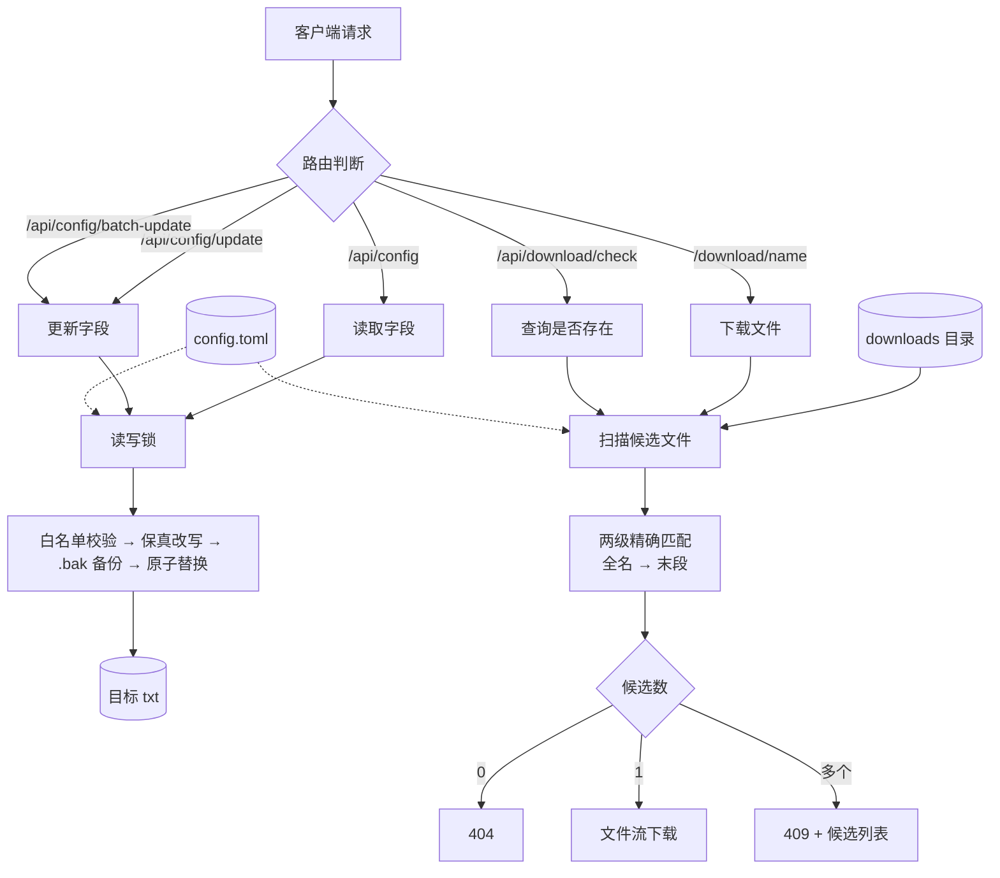

# config-api

[English](README.md) | **简体中文**

一个跑在内网的小 HTTP 服务，做两件事：**按请求改写纯文本配置文件里的字段值**，以及**按文件名从指定目录下载文件**。不需要数据库，目标机器不用装 Python / JVM / Rust。


> 功能已完整实现，可直接部署使用。想按阶段学习代码是怎么一步步写出来的，见文末「文档索引」。

## 功能一览

- 读取配置：`GET /api/config`
- 修改单个字段：`POST /api/config/update`
- 批量修改，全成功或全不改：`POST /api/config/batch-update`
- 字段白名单：只有 `config.toml` 里列出的字段能改
- 写入前自动生成 `.bak` 备份；写临时文件再原子替换，不会留下半截文件
- 下载文件：`GET /download/{name}`，只给编号也能找到带时间戳前缀的文件
- 先查再下：`POST /api/download/check`，返回是否存在、数量和文件名列表
- 下载目录、允许的文件类型、大小上限都在 `config.toml` 里配
- 启动期校验：配置写错立刻退出，不会带病运行
- 内置 Swagger UI：浏览器打开 `/docs/` 就能看到五个接口的文档，离线可用

## 工作原理



两条主线：配置改写经过读写锁、白名单和原子替换；下载走目录扫描和两级精确匹配。`config.toml` 同时决定能改哪些字段、从哪些目录下载、允许哪些类型。

另外有一个独立的 Swagger UI 路由 `/docs/`，它读取服务自己生成的 OpenAPI JSON（`/openapi.json`），不参与上面两条业务主线。

## 你会拿到什么

部署包只需要这几样：

```text
config-api/
├── config-api.exe      # Linux / macOS 为 config-api，无 .exe 后缀
├── config.toml         # 所有行为都在这里配
├── data/
│   ├── SmartViewConfig.txt   # 被改写的目标文件（换成你的真实文件）
│   └── downloads/            # 可被下载的文件放这里（示例文件可删）
└── README.md
```

目标机器**不需要任何运行环境**。把目录整体拷过去，改完 `config.toml` 就能跑。

## 快速开始

### 1. 改配置

打开 `config.toml`，至少确认三处：

- `[server].host`：只在本机用就保持 `127.0.0.1`；局域网其他机器要访问，写本机内网 IP（如 `192.168.1.10`）
- `[files].base_dir` 和 `file_name`：指向要改写的那个 txt
- `[download].roots`：指向允许下载的目录

> **Windows 路径里的反斜杠要写两遍**：`C:\\SmartView\\config`。写单反斜杠会解析失败。

### 2. 启动

Windows：双击 `config-api.exe`，或在 PowerShell 里运行：

```powershell
.\config-api.exe
```

开发机上也可以直接 `cargo run`。服务默认监听 `http://127.0.0.1:18981`。

想用另一份配置文件（比如测试用）：

```powershell
.\config-api.exe D:\config-api\config-test.toml
```

### 3. 验证

```bash
curl http://127.0.0.1:18981/api/config
```

看到 `{"ok":true,"file":"...","fields":[...]}` 就说明起来了。浏览器打开 `http://127.0.0.1:18981/docs/` 能看到接口文档，说明服务完全正常。

### 4. 停止

在运行窗口按 `Ctrl+C`；双击启动的窗口直接关掉即可。

## 配置文件详解

`config.toml` 和程序放在同一个目录。**相对路径都基于 `config.toml` 所在目录解析**，不是基于你双击程序时的工作目录。拼错任何键名都会启动失败。

```toml
[server]
host = "127.0.0.1"
port = 18981

[files]
base_dir = "./data"
file_name = "SmartViewConfig.txt"
backup = true

[allowed_fields]
fields = ["Thickness", "Temper", "Alloy", "Entry Width", "Exit Width", "DataName"]

[cors]
allowed_origins = []
allow_credentials = false

[download]
enabled = true
roots = ["./data/downloads"]
separator = "_"
extensions = ["txt", "csv", "xls", "xlsx"]
case_insensitive = true
max_file_size = 104857600
allow_subdirs = false
follow_symlinks = false
```

### 服务与文件

| 配置项 | 说明 |
|---|---|
| `server.host` | 监听 IP。必须写 IP，不能写域名。局域网访问写具体内网 IP |
| `server.port` | 端口，不能为 `0`。默认 `18981` |
| `files.base_dir` | 目标文件所在目录，启动时会检查存在 |
| `files.file_name` | 只写文件名，不能写路径 |
| `files.backup` | `true` 时每次改写前生成同目录 `.bak` |

### 可改字段白名单

`allowed_fields.fields` 列出允许通过接口修改的字段名。不在列表里的字段一律 400 拒绝。写接口只改 `@字段` 下面那一行的值，注释、空行、行尾风格原样保留。

### 下载设置

| 配置项 | 说明 |
|---|---|
| `download.enabled` | `false` 时不注册下载和查询接口 |
| `download.roots` | 允许下载的目录，可写多个；只从这些目录里找文件 |
| `separator` | 文件名切分符，默认 `_` |
| `extensions` | 允许的文件类型，小写、不带点。不在这个列表里的文件既不会被匹配也不会被下载 |
| `case_insensitive` | `true` 时忽略大小写，避免 Windows / Linux 行为不一致 |
| `max_file_size` | 单文件字节上限，超过就跳过；`0` 表示不限 |
| `allow_subdirs` | `false` 只扫目录顶层，`true` 递归子目录 |
| `follow_symlinks` | 保持 `false`，避免通过链接读到目录外的文件 |

### 浏览器跨域（一般不用改）

`[cors].allowed_origins` 留空数组表示只允许同源。有前端页面要跨域调用时，把页面地址写进去，例如 `["http://localhost:5173"]`。CORS 不是鉴权，别拿它当安全边界。

## 目标文件格式

被改写的 txt 是「`@字段名` 一行 + 值一行」：

```text
# 设备配置，请勿手改
@DataName
TT26071311A002

@Thickness
25
@Temper
T3
```

- 以 `@` 开头的行是字段名，紧跟着的下一行是值
- 注释、空行、行尾（CRLF / LF）原样保留，只替换值那一行
- 同一个字段出现两次会拒绝修改，避免改错
- 值不能含换行，也不能以 `@` 开头
- 文件请保存为 UTF-8；GBK 文件会乱码

## 下载文件怎么用

目录里有这样一个文件：

```text
data/downloads/20231123_164957_AS9283331.xlsx
```

下面三种请求都能取到它：

```bash
# 只给编号和类型（推荐）
curl -OJ http://127.0.0.1:18981/download/AS9283331.xlsx

# 只给编号，类型由配置里的 extensions 决定
curl -OJ http://127.0.0.1:18981/download/AS9283331

# 给完整文件名
curl -OJ http://127.0.0.1:18981/download/20231123_164957_AS9283331.xlsx
```

匹配规则只有两级，都是**精确比较**，没有模糊搜索：

1. 请求名等于完整文件名
2. 请求名等于按 `separator` 切出来的最后一段；只给编号时也允许和“末段去扩展名”比较

结果判定固定为：0 个候选返回 404；1 个返回文件；**多个一律返回 409 并列出候选全名，不会偷偷挑一个**。比如同目录下还有 `..._AS9283331.csv`，只给 `AS9283331` 就会返回 409，这时用完整文件名再请求一次即可。

下载响应带 `Content-Disposition: attachment`，浏览器会当作附件保存，中文文件名不会乱码。

## HTTP 接口

所有 JSON 接口的端口都是 `18981`（除非你改了配置）。

### 读取配置字段

```bash
curl http://127.0.0.1:18981/api/config
```

```json
{"ok":true,"file":"./data/SmartViewConfig.txt","fields":[{"name":"Thickness","value":"25"}]}
```

### 改一个字段

```bash
curl -X POST http://127.0.0.1:18981/api/config/update \
  -H "Content-Type: application/json" \
  -d '{"name":"Thickness","value":"25"}'
```

```json
{"ok":true,"file":"./data/SmartViewConfig.txt","applied":["Thickness"],"count":1}
```

### 批量改

任一项不合法或字段不存在，整个文件保持原样。

```bash
curl -X POST http://127.0.0.1:18981/api/config/batch-update \
  -H "Content-Type: application/json" \
  -d '{"items":[{"name":"Thickness","value":"25"},{"name":"Temper","value":"T3"}]}'
```

### 查文件在不在（不下载）

```bash
curl -X POST http://127.0.0.1:18981/api/download/check \
  -H "Content-Type: application/json" \
  -d '{"name":"A12331","type":"xls"}'
```

```json
{"exist":true,"count":1,"files":["20231209_120312_A12331.xls"]}
```

`type` 可省略；省略时返回所有类型。`files` 永远是数组，`count` 永远是数字；没找到是 `{"exist":false,"count":0,"files":[]}`，状态码仍是 200。`type` 必须是 `extensions` 里配过的类型，否则 400。

### PowerShell 写法

```powershell
Invoke-RestMethod -Uri http://127.0.0.1:18981/api/config/update -Method Post `
  -ContentType 'application/json' -Body '{"name":"Thickness","value":"25"}'

Invoke-WebRequest -Uri http://127.0.0.1:18981/download/AS9283331.xlsx -OutFile AS9283331.xlsx
```

### 接口文档（Swagger UI）

浏览器打开 `http://127.0.0.1:18981/docs/`，可以看到全部五个接口的请求体、参数和响应说明，也能在页面上直接发起请求。地址末尾的 `/` 不要省。

机器可读的 OpenAPI JSON 在 `http://127.0.0.1:18981/openapi.json`。

页面静态资源已打包进程序，内网机器不需要访问外网 CDN。如果 `download.enabled = false`，文档里仍会列出下载接口，但实际并未注册，以配置为准。

### 错误码

| 状态码 | 含义 |
|---|---|
| 400 | 参数不合法：字段不在白名单、值为空或含换行、`type` 不在允许列表 |
| 404 | 下载没找到匹配文件 |
| 409 | 下载匹配到多个文件，按返回的候选全名重试 |
| 500 | 读写文件失败，或目录不可访问 |

## 打包与分发

### 打包

```bash
cargo build --release
```

产物在 `target/release/config-api`（Windows 为 `target\release\config-api.exe`）。**不要用 `cargo run` 生成的 debug 版本分发**。

把下面这些打成一个 zip 即可：

```text
config-api-1.0.0-windows-x64/
├── config-api.exe
├── config.toml
├── data/SmartViewConfig.txt
├── data/downloads/
└── README.md
```

Swagger UI 的静态资源已经编进 exe，不用额外打包网页文件，目标机器也不需要访问外网 CDN。

### 目标机器上的步骤

1. 解压到任意目录（建议固定路径，方便写服务脚本）
2. 按实际情况改 `config.toml`
3. 把要改写的 txt 放到 `files.base_dir`，把要下载的文件放到 `download.roots`
4. 双击 exe 或命令行启动
5. 从另一台机器访问 `http://内网IP:18981/api/config` 验证

### 局域网访问

只在本机用：`host = "127.0.0.1"`，什么都不用改。

局域网其他机器要用：把 `host` 改成**本机的内网 IP**（例如 `192.168.1.10`），并在 Windows 防火墙放行 `18981` 端口：

```powershell
New-NetFirewallRule -DisplayName "config-api-18981" `
  -Direction Inbound -Protocol TCP -LocalPort 18981 `
  -RemoteAddress 192.168.1.0/24 -Action Allow
```

按实际网段和端口改。**部署完从外网或另一网段访问一次，确认端口不可达**——本方案不做登录鉴权，安全边界就是网络隔离。

### 跨平台注意

- macOS 版本只能在 macOS 上编译
- Linux 静态版（musl）不依赖目标机器的 glibc，适合麒麟、统信、openEuler
- Windows MSVC 版依赖 VC++ 运行库；裸机可用静态 CRT 版或安装 VC++ Redistributable
- 未签名的 exe 可能被杀毒软件误报，企业内部分发建议做代码签名

## 常见问题

| 现象 | 原因与解决 |
|---|---|
| 启动就退出，提示 `base_dir` 不存在 | 路径写错，或 Windows 反斜杠没双写 |
| 提示 `download.roots` 不存在 | 下载目录没建；按配置里的路径建好目录 |
| `Address already in use` | 端口被占用，改 `server.port` 或结束旧进程 |
| 局域网访问不到 | 检查 `host` 是否写成内网 IP、防火墙是否放行 |
| 下载返回 404 | 检查类型是否在 `extensions` 里、文件名末段是否匹配 |
| 下载返回 409 | 候选不唯一；用响应里列出的完整文件名重试 |
| 写文件报 `os error 32` | 文件被记事本或同步盘占用，关掉占用程序 |
| 中文乱码 | 目标文件是 GBK；另存为 UTF-8 |
| 浏览器提示 CORS | 把前端页面地址写进 `[cors].allowed_origins` |
| 打开 `/docs/` 是 404 | 地址末尾必须带 `/`；确认用的是包含 Swagger UI 的新版本程序 |

## 文档索引

- 本文：面向使用者的运行、配置、接口与打包说明
- [`docs/Windows打包分发速查.md`](docs/Windows打包分发速查.md)：拷贝到另一台 Windows 运行的最短清单与踩坑记录
- [`docs/Axum配置接口_完整实现与打包指南.md`](docs/Axum配置接口_完整实现与打包指南.md)：面向开发者，逐模块代码说明与打包矩阵
- [`docs/Axum配置接口_手把手教程.md`](docs/Axum配置接口_手把手教程.md)：面向学习者，从 Hello World 一步步推导到最终版本

## 许可证

基于 [MIT 协议](LICENSE) 发布。Copyright (c) 2026 jasonbu163
